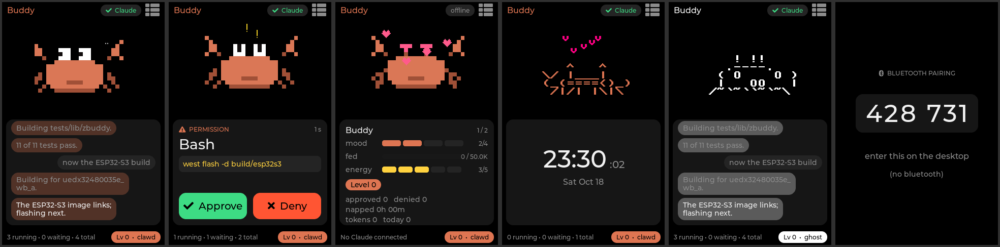

# zbuddy

<p align="center">
  
</p>

A desk pet for [Claude Desktop](https://claude.com/download) on
[Zephyr RTOS](https://zephyrproject.org): a port of Anthropic's
[claude-desktop-buddy](https://github.com/anthropics/claude-desktop-buddy),
with the Hardware Buddy protocol packaged as a Zephyr module. It sleeps when
idle, wakes when sessions start, and lets you approve or deny tool calls from
the device.

<p align="center">
  
</p>

- Hardware Buddy protocol over Bluetooth LE (Nordic UART Service, passkey pairing).
- The built-in clawd crab, character packs pushed from the desktop, or nineteen ASCII species.
- Approve or deny on the touch screen; LED and buzzer alert on pending prompts.
- Runs on the VIEWE UEDX32480035E-WB-A (ESP32-S3, 3.5" touch) and on `native_sim`.
- On Linux, `tools/claude_code_bridge.py` drives it from Claude Code hooks.
- Portable protocol library in `lib/zbuddy` with unit tests.

## Requirements

- Zephyr v4.5.0-rc2 (pinned in `west.yml`) and the Zephyr SDK
- The `lvgl`, `littlefs`, `mbedtls` and `hal_espressif` modules (pulled in by the manifest)
- SDL2 development package for `native_sim`

## Getting started

```sh
west init -m https://github.com/walidbadar/zbuddy --mr main zbuddy-workspace
cd zbuddy-workspace && west update
```

### ESP32-S3

```sh
west blobs fetch hal_espressif
west build -b uedx32480035e_wb_a/esp32s3/procpu -d build/esp32s3 zbuddy/app
west flash -d build/esp32s3
```

In Claude Desktop, enable developer mode (Help > Troubleshooting > Enable
Developer Mode), open Developer > Hardware Buddy, pick `Claude-XXXX` and enter
the passkey shown on the device.

### native_sim

```sh
west build -b native_sim/native/64 -d build/native zbuddy/app
./build/native/zephyr/zephyr.exe --flash=buddy.bin
zbuddy/tools/bridge_sim.py -p /dev/pts/N scenario busy   # N from the simulator output
```

### Linux with Claude Code

On Linux without Claude Desktop, `tools/claude_code_bridge.py` runs a daemon
that keeps the BLE link to the device and sends heartbeats. Claude Code hooks
forward session events to it and wait for Approve/Deny from the device. It
needs `pip install bleak`.

```sh
zbuddy/tools/bridge_sim.py pair Claude-XXXX                   # bond once, enter the passkey
zbuddy/tools/claude_code_bridge.py daemon -p ble:Claude-XXXX   # run in the foreground
zbuddy/tools/claude_code_bridge.py settings                    # hooks for ~/.claude/settings.json
```

To run the daemon as a systemd user service instead:

```sh
zbuddy/tools/claude_code_bridge.py install-service -p ble:Claude-XXXX
journalctl --user -u zbuddy-bridge -f   # log
systemctl --user stop zbuddy-bridge     # stop
```

`-p` also takes a serial port or the `native_sim` pseudo terminal. See
`doc/linux.rst` for details.

## Tests

```sh
west twister -p native_sim/native/64 -T zbuddy/tests
```

## Documentation

Controls, the library API, Kconfig options and the protocol are documented in
`doc/`:

```sh
pip install -r doc/requirements.txt && sphinx-build -b html doc doc/_build/html
```

## Licence

GPL-3.0-only. The ASCII species and pet behaviour are ported from
claude-desktop-buddy (Copyright 2026 Anthropic, PBC, MIT, see
`LICENSE.claude-desktop-buddy`). The clawd crab is original artwork.

Zephyr is a trademark of The Linux Foundation; Claude is a trademark of
Anthropic, PBC. This project is not affiliated with or endorsed by either.
